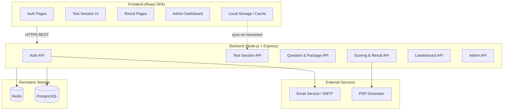
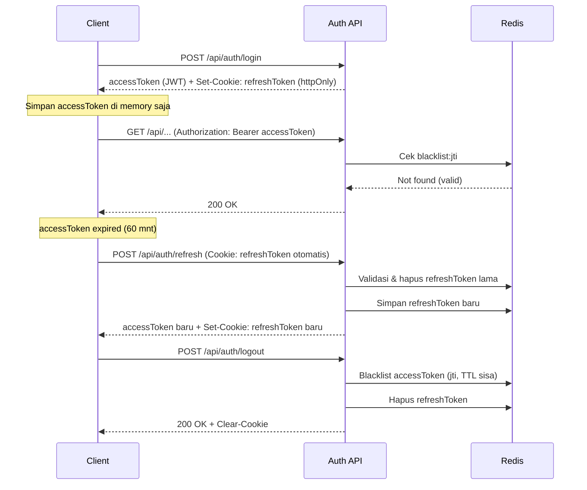
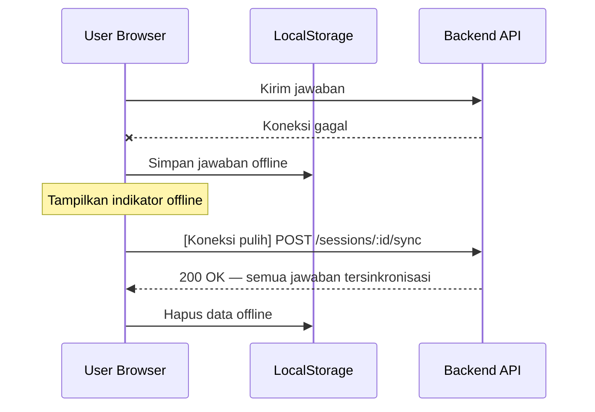

# Design Document

## Overview

Website Tes Potensi Akademik (Academic Potential Test) adalah platform web yang memungkinkan pengguna mengukur kemampuan akademik mereka melalui tes terstruktur mencakup kemampuan Verbal, Numerik, dan Logika. Platform ini mengelola seluruh siklus hidup tes: dari registrasi pengguna, pemilihan paket tes, pengerjaan tes secara real-time dengan timer, hingga penilaian, tampilan hasil, dan perbandingan skor via leaderboard.

**Tujuan utama platform:**
- Menyediakan tes akademik terstandar yang dapat diakses dari berbagai perangkat
- Memberikan hasil dan interpretasi yang akurat dan informatif
- Memungkinkan pengguna melacak perkembangan kemampuan mereka dari waktu ke waktu
- Mendukung admin dalam mengelola bank soal dan paket tes secara efisien

**Tech stack yang direkomendasikan:**
- **Frontend**: React (dengan TypeScript) — responsif, komponen-based, mendukung state management kompleks untuk sesi tes
- **Backend**: Node.js + Express (TypeScript) — REST API
- **Database**: PostgreSQL — relasional, cocok untuk data terstruktur tes dan hasil
- **Caching**: Redis — untuk leaderboard dan sesi tes
- **Auth**: JWT dengan refresh token
- **PDF Generation**: `pdf-lib` atau `puppeteer` untuk fitur unduh hasil
- **Testing (PBT)**: `fast-check` (JavaScript/TypeScript)

---

## Architecture

Platform menggunakan arsitektur **client-server** dengan pemisahan jelas antara frontend SPA dan backend REST API.



**Alur utama:**
1. Pengguna mendaftar → sistem kirim email verifikasi (via Email Service)
2. Pengguna login → sistem buat JWT session
3. Pengguna pilih paket tes → sistem buat `Sesi_Tes` baru
4. Selama tes: jawaban disimpan otomatis ke server; jika offline, disimpan ke LocalStorage dan disinkronkan saat koneksi pulih
5. Tes selesai → backend hitung skor, simpan `Hasil_Tes`, update leaderboard (async via Redis)
6. Pengguna lihat hasil → opsional unduh PDF

---

## Components and Interfaces

### Frontend Components

#### 1. Auth Module
- `RegisterForm` — form registrasi dengan validasi real-time (nama, email, password)
- `LoginForm` — form login dengan penanganan rate limiting (lockout 5x gagal)
- `EmailVerificationPage` — halaman konfirmasi setelah klik tautan verifikasi
- `ForgotPasswordForm` / `ResetPasswordForm` — alur reset kata sandi

#### 2. Test Selection Module
- `PackageListPage` — menampilkan daftar `Paket_Tes` yang aktif
- `PackageDetailPage` — halaman konfirmasi sebelum memulai tes
- `CategoryBadge` — komponen kecil penampil label kategori (Verbal, Numerik, Logika)

#### 3. Test Session Module
- `TestSessionPage` — halaman utama pengerjaan tes (orkestrasi semua komponen tes)
- `QuestionDisplay` — menampilkan satu soal beserta pilihan jawaban
- `AnswerSelector` — pilihan ganda (radio button) dengan state tersimpan
- `TimerDisplay` — countdown timer dengan update 1 detik
- `ProgressIndicator` — indikator "Soal X dari N"
- `NavigationButtons` — tombol Sebelumnya / Berikutnya (conditional rendering)
- `FinishConfirmationDialog` — dialog konfirmasi dengan info soal belum dijawab
- `OfflineSyncIndicator` — indikator status koneksi dan sinkronisasi

#### 4. Result Module
- `ResultPage` — halaman hasil lengkap
- `ScoreDisplay` — menampilkan `Skor_Total` dan `Skor_Kategori`
- `AbilityLabel` — label kemampuan (Di Bawah Rata-rata, Rata-rata, dll.)
- `AnswerReviewList` — daftar pembahasan jawaban per soal
- `DownloadPDFButton` — tombol unduh hasil sebagai PDF

#### 5. History & Progress Module
- `HistoryPage` — daftar riwayat tes dengan pagination (20 per halaman)
- `ProgressChart` — grafik perkembangan skor (sumbu Y: 0–100, sumbu X: waktu)
- `HistoryDetailPage` — detail satu sesi tes dari riwayat

#### 6. Leaderboard Module
- `LeaderboardPage` — papan peringkat per paket tes (top 100)
- `UserRankDisplay` — posisi peringkat pengguna yang sedang login
- `PackageSelector` — filter leaderboard berdasarkan paket tes

#### 7. Admin Module
- `AdminQuestionCRUD` — antarmuka create/read/update/delete soal
- `AdminPackageManager` — pengaturan soal ke paket tes, konfigurasi batas waktu
- `PackageActivationControl` — tombol aktivasi paket dengan validasi

### Backend API Endpoints

Semua endpoint menggunakan `Content-Type: application/json`. Endpoint yang membutuhkan autentikasi mewajibkan header `Authorization: Bearer <access_token>`.

#### Auth API (`/api/auth`)

##### `POST /api/auth/register`
Registrasi pengguna baru. Tidak memerlukan autentikasi.

```typescript
// Request Body
interface RegisterRequest {
  fullName: string;   // 1–100 karakter
  email: string;      // format valid, maks 254 karakter
  password: string;   // 8–128 karakter
}

// Response 201 Created
interface RegisterResponse {
  status: 'success';
  message: 'Akun berhasil dibuat. Email verifikasi telah dikirimkan.';
  data: { userId: string };
}
```

**HTTP Status Codes:**
| Status | Kondisi |
|--------|---------|
| 201 | Registrasi berhasil |
| 400 | Validasi gagal (nama kosong, email tidak valid, password pendek) |
| 409 | Email sudah terdaftar |
| 429 | Rate limit registrasi terlampaui |
| 500 | Internal server error |

---

##### `POST /api/auth/login`
Login dan buat sesi JWT. Tidak memerlukan autentikasi.

```typescript
// Request Body
interface LoginRequest {
  email: string;
  password: string;
}

// Response 200 OK
interface LoginResponse {
  status: 'success';
  data: {
    accessToken: string;   // JWT, expiry 60 menit
    refreshToken: string;  // opaque token, expiry 7 hari
    user: {
      id: string;
      fullName: string;
      email: string;
      role: 'user' | 'admin';
    };
  };
}
```

**HTTP Status Codes:**
| Status | Kondisi |
|--------|---------|
| 200 | Login berhasil |
| 400 | Body request tidak valid |
| 401 | Email atau password salah |
| 403 | Akun belum diverifikasi |
| 429 | Akun terkunci 15 menit (5x gagal berturut-turut) |
| 500 | Internal server error |

---

##### `POST /api/auth/verify-email`
Verifikasi email via token dari tautan. Tidak memerlukan autentikasi.

```typescript
// Request Body
interface VerifyEmailRequest {
  token: string;  // token dari URL tautan verifikasi
}

// Response 200 OK
interface VerifyEmailResponse {
  status: 'success';
  message: 'Email berhasil diverifikasi. Silakan login.';
}
```

**HTTP Status Codes:** `200`, `400` (token tidak valid / kedaluwarsa), `404` (token tidak ditemukan)

---

##### `POST /api/auth/resend-verification`
Kirim ulang email verifikasi. Tidak memerlukan autentikasi.

```typescript
// Request Body
interface ResendVerificationRequest {
  email: string;
}

// Response 200 OK — selalu 200 untuk mencegah email enumeration
interface ResendVerificationResponse {
  status: 'success';
  message: 'Jika email terdaftar dan belum terverifikasi, email verifikasi baru telah dikirimkan.';
}
```

**HTTP Status Codes:** `200` (selalu, termasuk jika email tidak ditemukan), `429` (rate limit: maks 3x per jam per email)

---

##### `POST /api/auth/forgot-password`
Kirim link reset password. Tidak memerlukan autentikasi.

**HTTP Status Codes:** `200` (selalu, untuk mencegah email enumeration), `429` (rate limit: maks 3x per jam per email)

---

##### `POST /api/auth/reset-password`
Reset password via token. Tidak memerlukan autentikasi.

```typescript
interface ResetPasswordRequest {
  token: string;
  newPassword: string;  // 8–128 karakter
}
```

**HTTP Status Codes:** `200`, `400` (token tidak valid / kedaluwarsa / password tidak memenuhi syarat)

---

##### `POST /api/auth/refresh`
Perbarui access token menggunakan refresh token.

```typescript
// Request Body
interface RefreshTokenRequest {
  refreshToken: string;
}

// Response 200 OK
interface RefreshTokenResponse {
  status: 'success';
  data: {
    accessToken: string;   // JWT baru, expiry 60 menit
    refreshToken: string;  // refresh token baru (rotation)
  };
}
```

**HTTP Status Codes:** `200`, `401` (refresh token tidak valid / kedaluwarsa / direvokasi)

---

##### `POST /api/auth/logout`
Invalidasi sesi. Memerlukan autentikasi.

```typescript
// Request Body
interface LogoutRequest {
  refreshToken: string;  // refresh token yang akan direvokasi
}
```

**HTTP Status Codes:** `200`, `401` (tidak terautentikasi)

---

#### Test Package API (`/api/packages`)

##### `GET /api/packages`
Daftar semua paket tes aktif. Memerlukan autentikasi.

**HTTP Status Codes:** `200`, `401`

---

##### `GET /api/packages/:id`
Detail satu paket tes. Memerlukan autentikasi.

**HTTP Status Codes:** `200`, `401`, `404`

---

#### Test Session API (`/api/sessions`)

##### `POST /api/sessions`
Buat sesi tes baru. Memerlukan autentikasi.

```typescript
// Request Body
interface CreateSessionRequest {
  packageId: string;  // UUID paket tes
}

// Response 201 Created
interface CreateSessionResponse {
  status: 'success';
  data: {
    sessionId: string;
    packageId: string;
    timeoutAt: string;       // ISO 8601 — batas waktu habis
    totalQuestions: number;
    questions: Array<{
      id: string;
      order: number;
      text: string;
      categoryId: string;
      options: Array<{ id: string; text: string }>;  // isCorrect tidak disertakan
    }>;
  };
}
```

**HTTP Status Codes:**
| Status | Kondisi |
|--------|---------|
| 201 | Sesi berhasil dibuat |
| 400 | packageId tidak valid |
| 401 | Tidak terautentikasi |
| 404 | Paket tes tidak ditemukan |
| 409 | Pengguna sudah memiliki sesi aktif untuk paket ini |

---

##### `GET /api/sessions/:id`
Ambil state sesi tes (untuk resume jika koneksi terputus). Memerlukan autentikasi, hanya pemilik sesi.

**HTTP Status Codes:** `200`, `401`, `403` (bukan pemilik sesi), `404`

---

##### `PUT /api/sessions/:id/answer`
Simpan atau update jawaban satu soal. Memerlukan autentikasi, hanya pemilik sesi.

```typescript
// Request Body
interface SaveAnswerRequest {
  questionId: string;
  selectedOptionId: string | null;  // null untuk membatalkan jawaban
}

// Response 200 OK
interface SaveAnswerResponse {
  status: 'success';
  data: {
    questionId: string;
    selectedOptionId: string | null;
    savedAt: string;  // ISO 8601
  };
}
```

**HTTP Status Codes:**
| Status | Kondisi |
|--------|---------|
| 200 | Jawaban tersimpan |
| 400 | questionId atau selectedOptionId tidak valid |
| 401 | Tidak terautentikasi |
| 403 | Bukan pemilik sesi |
| 404 | Sesi atau soal tidak ditemukan |
| 409 | Sesi sudah selesai (`SESSION_ALREADY_FINISHED`) |
| 410 | Sesi sudah habis waktu (`SESSION_TIMED_OUT`) |

---

##### `POST /api/sessions/:id/finish`
Selesaikan sesi tes secara manual. Memerlukan autentikasi, hanya pemilik sesi.

```typescript
// Request Body (opsional — untuk submit jawaban terakhir sekaligus)
interface FinishSessionRequest {
  finalAnswer?: {
    questionId: string;
    selectedOptionId: string | null;
  };
}

// Response 200 OK
interface FinishSessionResponse {
  status: 'success';
  data: {
    sessionId: string;
    resultId: string;   // ID Hasil_Tes yang baru dibuat
    totalScore: number;
    abilityLabel: string;
  };
}
```

**HTTP Status Codes:**
| Status | Kondisi |
|--------|---------|
| 200 | Sesi selesai, hasil tersimpan |
| 401 | Tidak terautentikasi |
| 403 | Bukan pemilik sesi |
| 404 | Sesi tidak ditemukan |
| 409 | Sesi sudah pernah diselesaikan |

---

##### `POST /api/sessions/:id/sync`
Sinkronisasi batch jawaban yang tersimpan offline. Memerlukan autentikasi, hanya pemilik sesi.

```typescript
// Request Body
interface SyncAnswersRequest {
  answers: Array<{
    questionId: string;
    selectedOptionId: string | null;
    savedAt: string;  // ISO 8601 — timestamp lokal saat jawaban disimpan
  }>;
}

// Response 200 OK
interface SyncAnswersResponse {
  status: 'success';
  data: {
    synced: number;     // jumlah jawaban yang berhasil disinkronisasi
    skipped: number;    // jawaban yang dilewati (lebih lama dari yang sudah di server)
    conflicts: Array<{ questionId: string; reason: string }>;
  };
}
```

**HTTP Status Codes:** `200`, `400` (format tidak valid), `401`, `403`, `404`, `409` (sesi sudah selesai)

---

#### Result API (`/api/results`)

##### `GET /api/results/:sessionId`
Ambil hasil tes lengkap. Memerlukan autentikasi, hanya pemilik hasil.

```typescript
// Response 200 OK
interface GetResultResponse {
  status: 'success';
  data: {
    resultId: string;
    sessionId: string;
    packageId: string;
    packageName: string;
    totalScore: number;           // 0.00–100.00
    abilityLabel: string;
    correctCount: number;
    incorrectCount: number;
    unansweredCount: number;
    completedAt: string;          // ISO 8601
    categoryScores: Array<{
      categoryId: string;
      categoryName: string;
      correctCount: number;
      totalCount: number;
      score: number;
    }>;
    answerReview: Array<{
      questionId: string;
      order: number;
      questionText: string;
      userSelectedOptionId: string | null;
      correctOptionId: string;
      isCorrect: boolean;
      explanation: string;        // maks 300 karakter
    }>;
  };
}
```

**HTTP Status Codes:**
| Status | Kondisi |
|--------|---------|
| 200 | Berhasil |
| 401 | Tidak terautentikasi |
| 403 | Bukan pemilik hasil |
| 404 | Hasil tidak ditemukan |

---

##### `GET /api/results/history`
Riwayat seluruh hasil tes pengguna dengan pagination. Memerlukan autentikasi.

Query parameters: `page` (default: 1), `pageSize` (default: 20, maks: 20), `packageId` (opsional, filter).

```typescript
// Response 200 OK
interface GetHistoryResponse {
  status: 'success';
  data: {
    items: Array<{
      resultId: string;
      sessionId: string;
      packageId: string;
      packageName: string;
      totalScore: number;
      abilityLabel: string;
      completedAt: string;  // ISO 8601
    }>;
    pagination: {
      page: number;
      pageSize: number;
      total: number;        // total item (bukan halaman)
      totalPages: number;
      hasNextPage: boolean;
      hasPrevPage: boolean;
    };
  };
}
```

**HTTP Status Codes:** `200`, `400` (query param tidak valid), `401`

---

##### `GET /api/results/:sessionId/pdf`
Generate dan unduh PDF hasil tes. Memerlukan autentikasi, hanya pemilik hasil.

**Response:** `application/pdf` stream dengan header `Content-Disposition: attachment; filename="hasil-tes-{sessionId}.pdf"`

**HTTP Status Codes:** `200`, `401`, `403`, `404`, `500` (PDF generation gagal)

---

#### Leaderboard API (`/api/leaderboard`)
| Method | Endpoint | Auth | Deskripsi |
|--------|----------|------|-----------|
| GET | `/:packageId` | ✓ | Top 100 leaderboard untuk paket |
| GET | `/:packageId/my-rank` | ✓ | Peringkat pengguna yang login |

**HTTP Status Codes:** `200`, `401`, `404` (paket tidak ditemukan), `503` (Redis tidak tersedia, fallback ke DB)

---

#### Admin API (`/api/admin`)
Seluruh endpoint admin memerlukan autentikasi dan role `admin`. Pengguna biasa yang mengakses endpoint ini akan mendapat `403 Forbidden`.

| Method | Endpoint | HTTP Status | Deskripsi |
|--------|----------|-------------|-----------|
| GET | `/questions` | 200, 401, 403 | List soal dengan pagination |
| POST | `/questions` | 201, 400, 401, 403 | Buat soal baru |
| GET | `/questions/:id` | 200, 401, 403, 404 | Detail soal |
| PUT | `/questions/:id` | 200, 400, 401, 403, 404 | Update soal |
| DELETE | `/questions/:id` | 200, 401, 403, 404 | Hapus soal |
| GET | `/packages` | 200, 401, 403 | List paket tes |
| POST | `/packages` | 201, 400, 401, 403 | Buat paket tes |
| PUT | `/packages/:id` | 200, 400, 401, 403, 404 | Update paket tes |
| POST | `/packages/:id/activate` | 200, 400, 401, 403, 404 | Aktivasi paket tes |

---

## Data Models

### User

```typescript
interface User {
  id: string;                    // UUID
  fullName: string;              // maks 100 karakter
  email: string;                 // maks 254 karakter, unik
  passwordHash: string;          // bcrypt hash
  status: 'unverified' | 'active' | 'suspended';
  emailVerificationToken: string | null;
  emailVerificationExpiry: Date | null;
  passwordResetToken: string | null;
  passwordResetExpiry: Date | null;
  loginAttempts: number;         // untuk rate limiting
  lockoutUntil: Date | null;     // null = tidak terkunci
  lastActivityAt: Date;          // untuk auto-logout 60 menit
  createdAt: Date;
  updatedAt: Date;
}
```

### TestCategory

```typescript
type TestCategoryType = 'verbal' | 'numeric' | 'logic';

interface TestCategory {
  id: string;
  name: string;                  // "Verbal" | "Numerik" | "Logika"
  type: TestCategoryType;
  description: string;
}
```

### Question (Soal)

```typescript
interface AnswerOption {
  id: string;
  text: string;
  isCorrect: boolean;
}

interface Question {
  id: string;
  text: string;                  // teks pertanyaan
  categoryId: string;            // FK ke TestCategory
  options: AnswerOption[];       // 2–5 pilihan, tepat 1 isCorrect = true
  explanation: string;           // maks 300 karakter
  createdBy: string;             // FK ke User (admin)
  createdAt: Date;
  updatedAt: Date;
}
```

### TestPackage (Paket_Tes)

```typescript
interface TestPackage {
  id: string;
  name: string;
  description: string;           // maks 300 karakter
  timeLimitMinutes: number;      // 1–180 menit
  status: 'draft' | 'active' | 'archived';
  categories: TestCategoryType[]; // kategori yang tercakup
  createdAt: Date;
  updatedAt: Date;
}

interface PackageQuestion {
  packageId: string;
  questionId: string;
  order: number;                 // urutan soal dalam paket
}
```

### TestSession (Sesi_Tes)

```typescript
interface SavedAnswer {
  questionId: string;
  selectedOptionId: string | null; // null = belum dijawab
  savedAt: Date;
}

interface TestSession {
  id: string;
  userId: string;                // FK ke User
  packageId: string;             // FK ke TestPackage
  status: 'in_progress' | 'completed' | 'timed_out';
  startedAt: Date;
  finishedAt: Date | null;
  timeoutAt: Date;               // startedAt + timeLimitMinutes
  answers: SavedAnswer[];
  syncPending: boolean;          // true jika ada jawaban belum tersinkron
  createdAt: Date;
}
```

### TestResult (Hasil_Tes)

```typescript
interface CategoryScore {
  categoryId: string;
  categoryName: string;
  correctCount: number;
  totalCount: number;
  score: number;                 // 0.00–100.00
}

type AbilityLabel = 
  | 'Di Bawah Rata-rata'   // skor 0–49
  | 'Rata-rata'             // skor 50–69
  | 'Di Atas Rata-rata'    // skor 70–84
  | 'Unggul';               // skor 85–100

interface TestResult {
  id: string;
  sessionId: string;             // FK ke TestSession
  userId: string;                // FK ke User
  packageId: string;             // FK ke TestPackage
  totalScore: number;            // 0.00–100.00, 2 desimal
  abilityLabel: AbilityLabel;
  categoryScores: CategoryScore[];
  correctCount: number;
  incorrectCount: number;
  unansweredCount: number;
  completedAt: Date;
  createdAt: Date;
}
```

### Leaderboard Entry

```typescript
interface LeaderboardEntry {
  userId: string;
  fullName: string;
  packageId: string;
  bestScore: number;             // skor tertinggi dari semua sesi
  rank: number;
  completedAt: Date;             // waktu sesi dengan skor terbaik
}
```

---

## Correctness Properties

*A property is a characteristic or behavior that should hold true across all valid executions of a system — essentially, a formal statement about what the system should do. Properties serve as the bridge between human-readable specifications and machine-verifiable correctness guarantees.*

### Property 1: Kalkulasi Skor Keseluruhan Akurat

*For any* sesi tes yang telah selesai dengan jumlah soal N dan jumlah jawaban benar C, skor keseluruhan yang dihitung oleh sistem SHALL sama dengan `round((C / N) * 100, 2)`, menghasilkan nilai dalam rentang `[0.00, 100.00]`.

**Validates: Requirements 4.1**

---

### Property 2: Kalkulasi Skor Kategori Konsisten dengan Skor Keseluruhan

*For any* sesi tes yang mencakup beberapa kategori, skor per kategori harus dihitung secara independen menggunakan formula yang sama, dan rata-rata tertimbang dari semua skor kategori harus konsisten dengan skor keseluruhan.

**Validates: Requirements 4.2**

---

### Property 3: Label Kemampuan Selalu Sesuai Rentang Skor

*For any* nilai `totalScore` dalam rentang `[0.00, 100.00]`, label kemampuan yang ditetapkan oleh sistem harus tepat satu label yang sesuai: "Di Bawah Rata-rata" (0–49), "Rata-rata" (50–69), "Di Atas Rata-rata" (70–84), atau "Unggul" (85–100).

**Validates: Requirements 5.2**

---

### Property 4: Validasi Input Soal Menolak Konfigurasi Tidak Valid

*For any* soal yang dikirimkan oleh admin, sistem harus menerima soal jika dan hanya jika soal tersebut memiliki teks pertanyaan tidak kosong, antara 2–5 pilihan jawaban, dan tepat satu pilihan yang ditandai benar.

**Validates: Requirements 8.2**

---

### Property 5: Validasi Paket Tes — Jumlah Soal

*For any* paket tes yang akan diaktifkan, sistem SHALL mengizinkan aktivasi jika dan hanya jika jumlah soal dalam paket berada dalam rentang `[10, 100]`; di luar rentang tersebut sistem SHALL menolak aktivasi.

**Validates: Requirements 8.5, 8.6**

---

### Property 6: Leaderboard Menggunakan Skor Tertinggi

*For any* pengguna dengan lebih dari satu sesi tes untuk paket yang sama, peringkat pengguna di leaderboard SHALL ditentukan oleh nilai skor tertinggi dari seluruh sesi tes pengguna tersebut, bukan skor terbaru.

**Validates: Requirements 7.5**

---

### Property 7: Jawaban Offline Tersinkronisasi Lengkap

*For any* set jawaban yang disimpan secara lokal selama koneksi terputus, setelah koneksi pulih dan proses sinkronisasi selesai, seluruh jawaban tersebut SHALL tersimpan di server dan tidak ada jawaban yang hilang.

**Validates: Requirements 3.9, 3.10**

---

### Property 8: Navigasi Soal Mempertahankan Jawaban Tersimpan

*For any* sesi tes aktif, ketika pengguna menavigasi dari soal A ke soal B dan kembali ke soal A, jawaban yang sebelumnya dipilih pada soal A harus tetap tersimpan dan ditampilkan.

**Validates: Requirements 3.6**

---

### Property 9: Validasi Registrasi — Field Constraints

*For any* kombinasi input registrasi, sistem SHALL menolak pendaftaran jika: nama lengkap kosong, atau format email tidak valid, atau panjang kata sandi kurang dari 8 karakter; dan SHALL menerima pendaftaran hanya jika seluruh constraint terpenuhi.

**Validates: Requirements 1.1, 1.3**

---

### Property 10: Rate Limiting Login

*For any* akun pengguna, setelah tepat 5 percobaan login yang gagal secara berturut-turut, sistem SHALL memblokir percobaan login berikutnya dari akun tersebut selama minimal 15 menit.

**Validates: Requirements 1.9**

---

## Security of Data

### Authentication & Authorization

#### JWT Strategy

Platform menggunakan **dual-token model**: access token berumur pendek dan refresh token berumur panjang.

```
Access Token:  JWT, HS256, expiry 60 menit
Refresh Token: opaque token (UUID v4), expiry 7 hari, disimpan di Redis
```

Setiap request yang membutuhkan autentikasi melalui middleware JWT validation:

```typescript
// Middleware JWT validation (pseudocode)
async function jwtMiddleware(req, res, next) {
  const token = req.headers['authorization']?.split(' ')[1];
  if (!token) return res.status(401).json({ code: 'MISSING_TOKEN' });

  try {
    const payload = jwt.verify(token, JWT_SECRET, { algorithms: ['HS256'] });
    // Cek apakah token masuk blacklist (untuk kasus logout / revokasi)
    const isRevoked = await redis.get(`blacklist:${payload.jti}`);
    if (isRevoked) return res.status(401).json({ code: 'TOKEN_REVOKED' });
    req.user = payload;
    next();
  } catch (err) {
    return res.status(401).json({ code: 'INVALID_TOKEN' });
  }
}
```

**JWT Payload:**
```typescript
interface JWTPayload {
  sub: string;       // user ID
  role: 'user' | 'admin';
  jti: string;       // JWT ID unik, untuk blacklisting
  iat: number;
  exp: number;
}
```

#### Refresh Token Rotation

Setiap penggunaan refresh token akan **menghasilkan refresh token baru** dan **merevokasi token lama**. Ini mencegah token replay attack.

```
Client kirim refreshToken lama
  → Server validasi di Redis
  → Server buat accessToken baru + refreshToken baru
  → Server hapus refreshToken lama dari Redis
  → Server simpan refreshToken baru ke Redis
  → Response: accessToken baru + refreshToken baru
```

Jika refresh token sudah digunakan sebelumnya (token reuse detection), semua refresh token untuk user tersebut direvokasi (indikasi pencurian token).

#### Token Revocation via Redis Blacklist

Saat logout, access token yang masih aktif dimasukkan ke Redis blacklist dengan TTL sama dengan sisa masa berlaku token:

```
redis.set(`blacklist:${jti}`, '1', 'EX', remainingTTL)
```

#### Role-Based Access Control (RBAC)

| Role | Akses |
|------|-------|
| `user` | Semua endpoint publik + `/api/sessions`, `/api/results`, `/api/leaderboard` |
| `admin` | Semua akses `user` + seluruh endpoint `/api/admin/*` |

Middleware RBAC dipasang setelah JWT middleware:

```typescript
function requireRole(role: 'user' | 'admin') {
  return (req, res, next) => {
    if (req.user.role !== role && req.user.role !== 'admin') {
      return res.status(403).json({ code: 'INSUFFICIENT_PERMISSION' });
    }
    next();
  };
}
```

Selain role, resource ownership juga divalidasi: pengguna hanya dapat mengakses sesi dan hasil tes milik mereka sendiri (`session.userId === req.user.sub`).

---

### Data Validation & Sanitization

#### Input Validation

Semua input dari client divalidasi sebelum diproses menggunakan library schema validation (mis. `zod` atau `joi`):

- **Tipe data**: field numerik divalidasi sebagai number, bukan string
- **Panjang string**: semua field string memiliki batas maksimal eksplisit
- **Format**: email, UUID, dan ISO 8601 divalidasi dengan regex atau parser spesifik
- **Enum**: field dengan nilai terbatas (role, status) divalidasi terhadap whitelist

```typescript
// Contoh schema validasi Zod untuk registrasi
const registerSchema = z.object({
  fullName: z.string().min(1).max(100).trim(),
  email: z.string().email().max(254).toLowerCase(),
  password: z.string().min(8).max(128),
});
```

#### XSS Prevention

- Semua string input di-**strip HTML tags** sebelum disimpan (library: `DOMPurify` di frontend, `sanitize-html` di backend)
- Response API menggunakan `Content-Type: application/json`, bukan HTML — secara inheren tidak dieksekusi browser sebagai markup
- Header `X-Content-Type-Options: nosniff` dipasang pada semua response

#### SQL Injection Prevention

Platform menggunakan **parameterized queries** via ORM (mis. Prisma atau TypeORM). Query raw dilarang kecuali jika benar-benar diperlukan, dan hanya menggunakan prepared statements:

```typescript
// ✅ Aman — parameterized query via ORM
const user = await prisma.user.findUnique({ where: { email } });

// ❌ Dilarang — string concatenation
const user = await db.query(`SELECT * FROM users WHERE email = '${email}'`);
```

#### Output Encoding

- Data yang dikembalikan ke client melalui JSON response — karakter spesial secara otomatis di-encode oleh `JSON.stringify`
- PDF generation menggunakan library yang mem-escape input sebelum merender ke dokumen

---

### Sensitive Data Protection

#### Password Hashing

Password tidak pernah disimpan dalam bentuk plaintext. Hashing menggunakan **bcrypt** dengan cost factor 12:

```typescript
const BCRYPT_COST = 12;

async function hashPassword(plaintext: string): Promise<string> {
  return bcrypt.hash(plaintext, BCRYPT_COST);
}

async function verifyPassword(plaintext: string, hash: string): Promise<boolean> {
  return bcrypt.compare(plaintext, hash);
}
```

Cost factor 12 dipilih karena menghasilkan waktu hashing ~300ms di hardware modern, cukup mahal untuk memperlambat serangan brute-force namun tetap nyaman untuk operasi login normal.

#### PII Handling

| Data | Perlakuan |
|------|-----------|
| Password | Bcrypt hash, cost 12 |
| Email | Disimpan lowercase; tidak dikirim kembali dalam response list/leaderboard |
| Nama lengkap | Disimpan plaintext; hanya tampil di leaderboard dan profil pengguna sendiri |
| Refresh token | Disimpan di Redis (bukan DB relasional); dihash SHA-256 sebelum disimpan |
| Reset/verifikasi token | Disimpan sebagai hash; token plaintext hanya ada di email |

#### Logging & Audit

- Log tidak boleh mengandung password, token, atau konten jawaban pengguna
- Log menyimpan: user ID (bukan email), endpoint, status code, timestamp, dan IP address (di-hash untuk privasi)
- Log dirotasi setiap 7 hari dan disimpan terenkripsi

---

### Transport Security

#### HTTPS Enforcement

Semua traffic menggunakan HTTPS. HTTP redirect ke HTTPS dengan kode status `301 Permanent Redirect`. Konfigurasi Nginx/reverse proxy:

```nginx
server {
  listen 80;
  return 301 https://$host$request_uri;
}
```

#### Security Headers

Seluruh response API menyertakan header keamanan berikut:

| Header | Nilai | Tujuan |
|--------|-------|--------|
| `Strict-Transport-Security` | `max-age=31536000; includeSubDomains` | Paksa HTTPS untuk 1 tahun (HSTS) |
| `X-Content-Type-Options` | `nosniff` | Cegah MIME-type sniffing |
| `X-Frame-Options` | `DENY` | Cegah clickjacking |
| `Content-Security-Policy` | `default-src 'self'` | Batasi sumber resource |
| `Referrer-Policy` | `strict-origin-when-cross-origin` | Kontrol referrer info |

---

### Rate Limiting

Rate limiting diimplementasikan di layer API menggunakan Redis sebagai counter (sliding window algorithm).

| Endpoint | Limit | Window | Respons saat limit |
|----------|-------|--------|--------------------|
| `POST /api/auth/register` | 5 request | 1 jam per IP | `429` |
| `POST /api/auth/login` | 10 request | 15 menit per IP | `429` |
| Login per akun (bukan IP) | 5 request gagal | Session | `429` + lockout 15 menit |
| `POST /api/auth/forgot-password` | 3 request | 1 jam per email | `429` |
| `POST /api/auth/resend-verification` | 3 request | 1 jam per email | `429` |
| `POST /api/auth/refresh` | 20 request | 1 jam per user | `429` |
| API umum (semua endpoint auth-protected) | 300 request | 1 menit per user | `429` |

Response `429` menyertakan header `Retry-After` dengan nilai detik hingga window reset.

```typescript
// Contoh response 429
{
  "status": "error",
  "code": "RATE_LIMIT_EXCEEDED",
  "message": "Terlalu banyak percobaan. Coba lagi dalam 15 menit.",
  "retryAfter": 900  // detik
}
```

---

### Session Security

#### Access Token

- Algoritma: `HS256` dengan secret key minimum 256-bit yang disimpan di environment variable
- Expiry: **60 menit** (sesuai Req 1.11)
- Tidak disimpan di `localStorage` — disimpan di **memory** (React state) untuk mencegah XSS token theft
- Payload mengandung `jti` (JWT ID) untuk keperluan blacklisting

#### Refresh Token

- Format: UUID v4 opaque (tidak mengandung informasi)
- Disimpan di **httpOnly cookie** sehingga tidak dapat diakses JavaScript
- Cookie attributes: `Secure`, `HttpOnly`, `SameSite=Strict`
- Disimpan di Redis sebagai hash SHA-256 dengan TTL 7 hari
- **Rotation** setiap penggunaan — token lama langsung diinvalidasi

#### Auto-Logout

Inaktivitas 60 menit dideteksi di sisi client (event listener pada user interaction). Jika tidak ada aktivitas selama 60 menit, client menghapus access token dari memory dan mengarahkan pengguna ke halaman login. Refresh token di cookie otomatis kedaluwarsa sesuai TTL-nya.



---

## Error Handling

### Strategi Umum

Platform menggunakan model error terpusat dengan kategori berikut:

| Kategori | HTTP Status | Deskripsi |
|----------|-------------|-----------|
| Validation Error | 400 | Input tidak valid (field constraint, format) |
| Authentication Error | 401 | Sesi tidak valid atau belum login |
| Authorization Error | 403 | Tidak punya izin akses resource |
| Not Found | 404 | Resource tidak ditemukan |
| Conflict | 409 | Email sudah terdaftar, dll. |
| Rate Limit | 429 | Login lockout, request throttling |
| Internal Error | 500 | Kesalahan server yang tidak terduga |

### Error Response Format

```typescript
interface ErrorResponse {
  status: 'error';
  code: string;        // machine-readable, e.g. "EMAIL_ALREADY_EXISTS"
  message: string;     // human-readable dalam Bahasa Indonesia
  fields?: Record<string, string>; // untuk validation errors, field → pesan
}
```

### Penanganan Per Modul

**Auth:**
- Email duplikat → `409 CONFLICT` dengan pesan "Email sudah terdaftar"
- Login gagal → `401` dengan pesan "Email atau kata sandi salah" (tanpa detail mana yang salah)
- Login lockout → `429` dengan pesan yang menyebut durasi pemblokiran (15 menit)
- Token verifikasi kedaluwarsa → `400` dengan opsi resend

**Test Session:**
- Sesi tidak ditemukan → `404`
- Sesi sudah selesai, mencoba update jawaban → `409 SESSION_ALREADY_FINISHED`
- Timer habis → sistem otomatis finish sesi dan simpan jawaban terakhir
- Koneksi putus → jawaban disimpan ke LocalStorage; indikator offline ditampilkan

**Scoring:**
- Gagal simpan `Hasil_Tes` ke DB → tampilkan error, simpan ke LocalStorage sebagai backup (Req 4.4, 4.5)
- Gagal generate PDF → tampilkan pesan error, data `Hasil_Tes` tidak terubah (Req 5.5)

**Admin:**
- Soal tidak memenuhi validasi → `400` dengan detail field yang tidak valid
- Aktivasi paket dengan soal < 10 atau > 100 → `400` dengan pesan jumlah soal tidak memenuhi syarat

**Leaderboard:**
- Data tidak dapat dimuat → tampilkan pesan error dengan opsi retry (Req 7.7)
- Data diperbarui secara asinkron via Redis; staleness maksimal 60 detik (Req 7.6)

### Offline Resilience



---

## Testing Strategy

### Pendekatan Dual Testing

Platform menggunakan dua pendekatan pengujian yang saling melengkapi:

1. **Unit Tests (example-based)** — untuk perilaku spesifik, edge case, dan integrasi antar komponen
2. **Property-Based Tests (PBT)** — untuk memverifikasi properti universal yang berlaku pada semua input yang valid

Library PBT yang digunakan: **`fast-check`** (TypeScript/JavaScript)

### Unit Tests

**Auth Module:**
- Registrasi berhasil dengan data valid
- Registrasi gagal: email duplikat, email format tidak valid, password terlalu pendek, nama kosong
- Login berhasil → JWT token dibuat
- Login gagal 5x → lockout aktif, request ke-6 ditolak
- Token verifikasi email kedaluwarsa → error + opsi resend
- Auto-logout setelah 60 menit inaktivitas

**Test Session Module:**
- Timer menghitung mundur dan trigger auto-finish saat mencapai nol
- Navigasi soal menyimpan jawaban
- Dialog konfirmasi menampilkan jumlah soal belum dijawab
- Sinkronisasi offline berjalan dalam ≤10 detik setelah koneksi pulih

**Scoring Module:**
- Skor 0 saat semua jawaban salah
- Skor 100 saat semua jawaban benar
- Pembulatan 2 desimal

**Leaderboard:**
- Leaderboard diperbarui dalam ≤60 detik
- Hanya skor tertinggi yang digunakan untuk peringkat

**Admin Module:**
- Soal dengan 0 pilihan benar ditolak
- Soal dengan 2+ pilihan benar ditolak
- Paket dengan 9 soal tidak bisa diaktifkan
- Paket dengan 101 soal tidak bisa diaktifkan

### Property-Based Tests

Setiap property test dikonfigurasi untuk minimum **100 iterasi** dengan `fast-check`.

Setiap test diberi tag komentar dengan format:
`// Feature: academic-potential-test, Property {N}: {deskripsi singkat}`

#### Property 1: Kalkulasi Skor Keseluruhan

```typescript
// Feature: academic-potential-test, Property 1: skor keseluruhan akurat
fc.assert(fc.property(
  fc.integer({ min: 1, max: 100 }),   // total soal N
  fc.integer({ min: 0 }),              // jawaban benar C (dibatasi <= N di dalam)
  (n, rawC) => {
    const c = Math.min(rawC, n);
    const expectedScore = Math.round((c / n) * 100 * 100) / 100;
    const result = calculateTotalScore(c, n);
    return result === expectedScore && result >= 0 && result <= 100;
  }
), { numRuns: 100 });
```

#### Property 2: Kalkulasi Skor Kategori

```typescript
// Feature: academic-potential-test, Property 2: skor kategori konsisten
fc.assert(fc.property(
  fc.array(
    fc.record({ correct: fc.integer({ min: 0, max: 50 }), total: fc.integer({ min: 1, max: 50 }) }),
    { minLength: 1, maxLength: 3 }
  ),
  (categories) => {
    const normalizedCategories = categories.map(c => ({
      correct: Math.min(c.correct, c.total),
      total: c.total,
    }));
    const categoryScores = normalizedCategories.map(c =>
      Math.round((c.correct / c.total) * 100 * 100) / 100
    );
    // Setiap skor kategori harus dalam rentang [0, 100]
    return categoryScores.every(s => s >= 0 && s <= 100);
  }
), { numRuns: 100 });
```

#### Property 3: Label Kemampuan

```typescript
// Feature: academic-potential-test, Property 3: label kemampuan selalu valid
fc.assert(fc.property(
  fc.float({ min: 0, max: 100 }),
  (score) => {
    const label = getAbilityLabel(score);
    if (score <= 49) return label === 'Di Bawah Rata-rata';
    if (score <= 69) return label === 'Rata-rata';
    if (score <= 84) return label === 'Di Atas Rata-rata';
    return label === 'Unggul';
  }
), { numRuns: 500 });
```

#### Property 4: Validasi Input Soal

```typescript
// Feature: academic-potential-test, Property 4: validasi soal menerima/menolak dengan benar
fc.assert(fc.property(
  fc.record({
    text: fc.string(),
    options: fc.array(
      fc.record({ text: fc.string(), isCorrect: fc.boolean() }),
      { minLength: 0, maxLength: 6 }
    ),
  }),
  ({ text, options }) => {
    const result = validateQuestion({ text, options });
    const hasText = text.trim().length > 0;
    const optCount = options.length;
    const correctCount = options.filter(o => o.isCorrect).length;
    const shouldBeValid = hasText && optCount >= 2 && optCount <= 5 && correctCount === 1;
    return result.valid === shouldBeValid;
  }
), { numRuns: 200 });
```

#### Property 5: Validasi Paket Tes

```typescript
// Feature: academic-potential-test, Property 5: validasi jumlah soal paket
fc.assert(fc.property(
  fc.integer({ min: 0, max: 120 }),
  (questionCount) => {
    const result = validatePackageActivation({ questionCount });
    const shouldBeValid = questionCount >= 10 && questionCount <= 100;
    return result.canActivate === shouldBeValid;
  }
), { numRuns: 100 });
```

#### Property 6: Leaderboard Skor Tertinggi

```typescript
// Feature: academic-potential-test, Property 6: leaderboard menggunakan skor tertinggi
fc.assert(fc.property(
  fc.array(fc.float({ min: 0, max: 100 }), { minLength: 1, maxLength: 20 }),
  (scores) => {
    const bestScore = getBestScoreForLeaderboard(scores);
    return bestScore === Math.max(...scores);
  }
), { numRuns: 100 });
```

#### Property 7: Jawaban Offline Tersinkronisasi Lengkap

```typescript
// Feature: academic-potential-test, Property 7: sinkronisasi offline lengkap
fc.assert(fc.property(
  fc.array(
    fc.record({ questionId: fc.uuid(), selectedOptionId: fc.uuid() }),
    { minLength: 1, maxLength: 50 }
  ),
  (offlineAnswers) => {
    const syncResult = syncOfflineAnswers(offlineAnswers);
    // Semua jawaban offline harus tersinkronisasi, tidak ada yang hilang
    return offlineAnswers.every(a =>
      syncResult.synced.some(s => s.questionId === a.questionId && s.selectedOptionId === a.selectedOptionId)
    );
  }
), { numRuns: 100 });
```

#### Property 8: Navigasi Soal Mempertahankan Jawaban

```typescript
// Feature: academic-potential-test, Property 8: navigasi tidak menghapus jawaban
fc.assert(fc.property(
  fc.array(fc.uuid(), { minLength: 2, maxLength: 30 }),  // question IDs
  fc.integer({ min: 0 }),                                  // index soal awal
  fc.uuid(),                                               // selected option ID
  (questionIds, rawIdx, selectedOptionId) => {
    const idx = rawIdx % questionIds.length;
    const session = createTestSession(questionIds);
    saveAnswer(session, questionIds[idx], selectedOptionId);
    // Navigasi ke soal lain
    const otherIdx = (idx + 1) % questionIds.length;
    navigateTo(session, otherIdx);
    // Kembali ke soal awal
    navigateTo(session, idx);
    return getAnswer(session, questionIds[idx]) === selectedOptionId;
  }
), { numRuns: 100 });
```

#### Property 9: Validasi Registrasi

```typescript
// Feature: academic-potential-test, Property 9: validasi registrasi konsisten
fc.assert(fc.property(
  fc.record({
    fullName: fc.string(),
    email: fc.string(),
    password: fc.string(),
  }),
  ({ fullName, email, password }) => {
    const result = validateRegistration({ fullName, email, password });
    const nameValid = fullName.trim().length > 0 && fullName.length <= 100;
    const emailValid = isValidEmailFormat(email) && email.length <= 254;
    const passwordValid = password.length >= 8 && password.length <= 128;
    const shouldBeValid = nameValid && emailValid && passwordValid;
    return result.valid === shouldBeValid;
  }
), { numRuns: 200 });
```

#### Property 10: Rate Limiting Login

```typescript
// Feature: academic-potential-test, Property 10: lockout setelah 5 gagal
fc.assert(fc.property(
  fc.integer({ min: 5, max: 20 }),  // jumlah percobaan gagal
  (failedAttempts) => {
    const authState = simulateFailedLogins(failedAttempts);
    // Setelah >= 5 gagal, akun harus terkunci minimal 15 menit
    return authState.isLocked && authState.lockDurationMinutes >= 15;
  }
), { numRuns: 100 });
```

### Integration Tests

- End-to-end alur registrasi → verifikasi email → login → mulai tes → finish → lihat hasil
- Sinkronisasi jawaban offline dengan mock network interruption
- Leaderboard update setelah sesi tes selesai
- PDF generation dengan data hasil tes valid
- Admin: create question → assign to package → activate package → accessible oleh user

### Accessibility Tests (WCAG 2.1 Level AA)

- Validasi contrast ratio ≥ 4.5:1 menggunakan `axe-core`
- Pengujian navigasi keyboard pada halaman tes
- Screen reader compatibility test (label ARIA)
- Touch target size ≥ 44×44px pada komponen mobile

> **Catatan**: Validasi WCAG penuh memerlukan pengujian manual dengan assistive technology dan expert accessibility review. Automated tools seperti `axe-core` hanya mencakup sebagian dari kriteria WCAG 2.1 Level AA.
